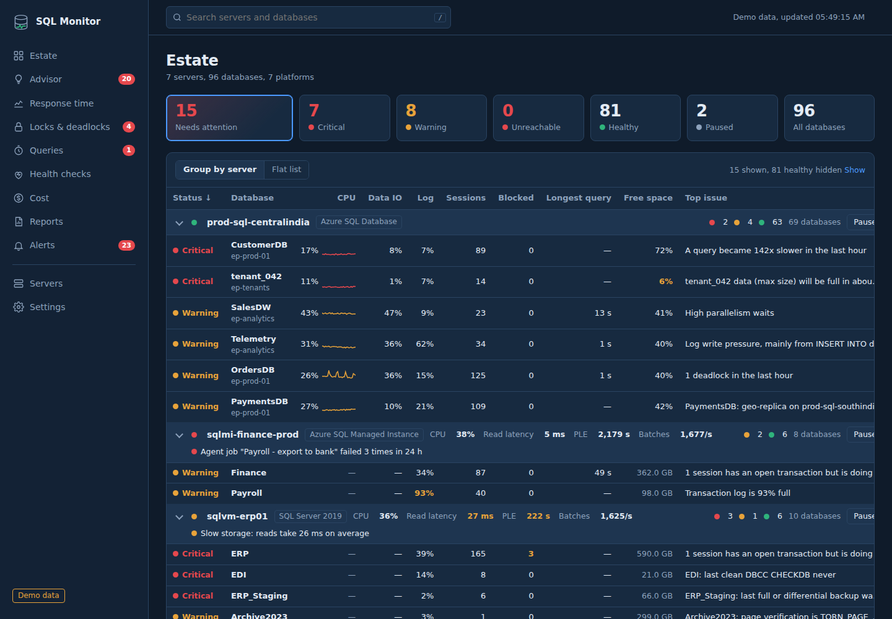
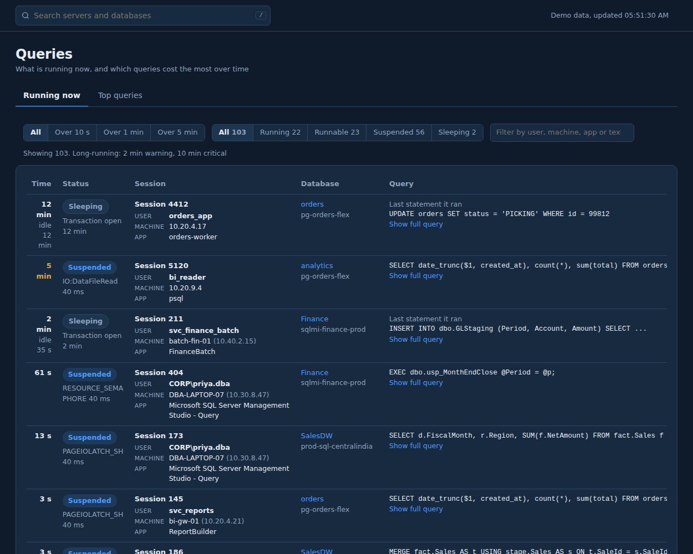
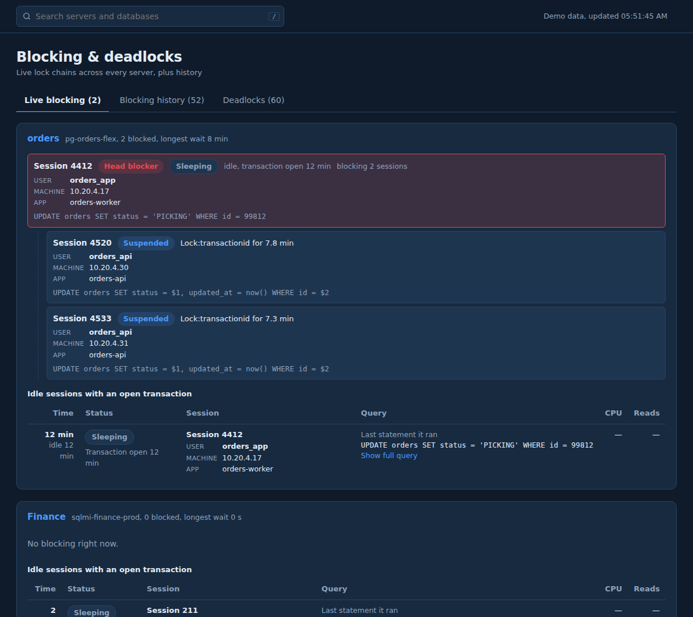
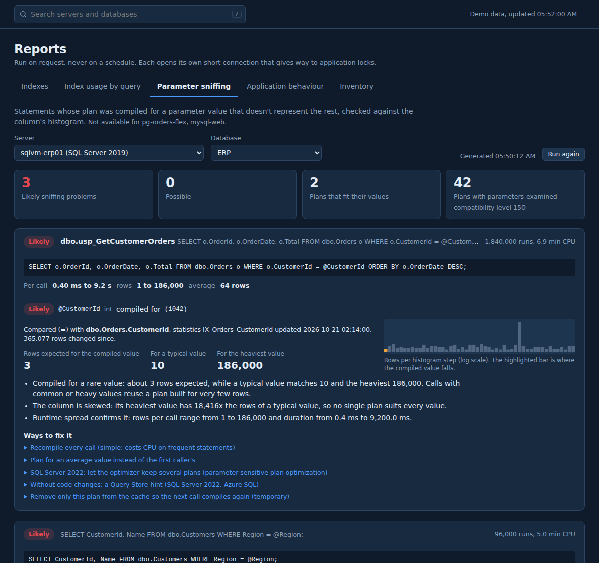
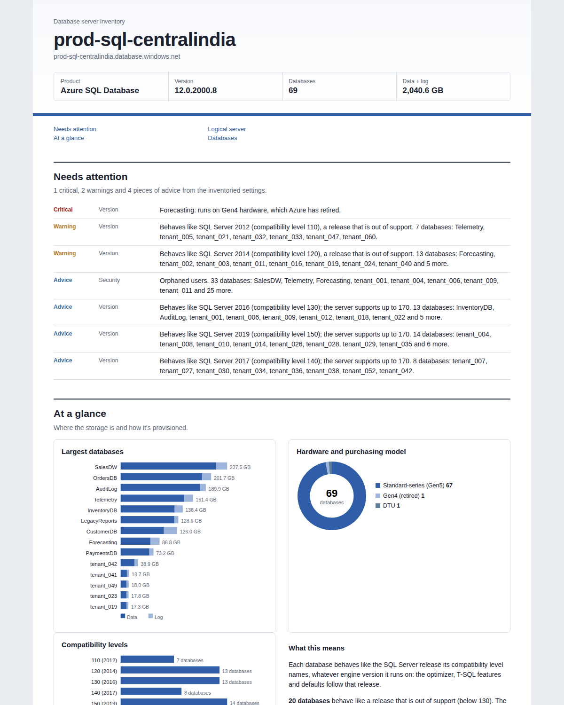
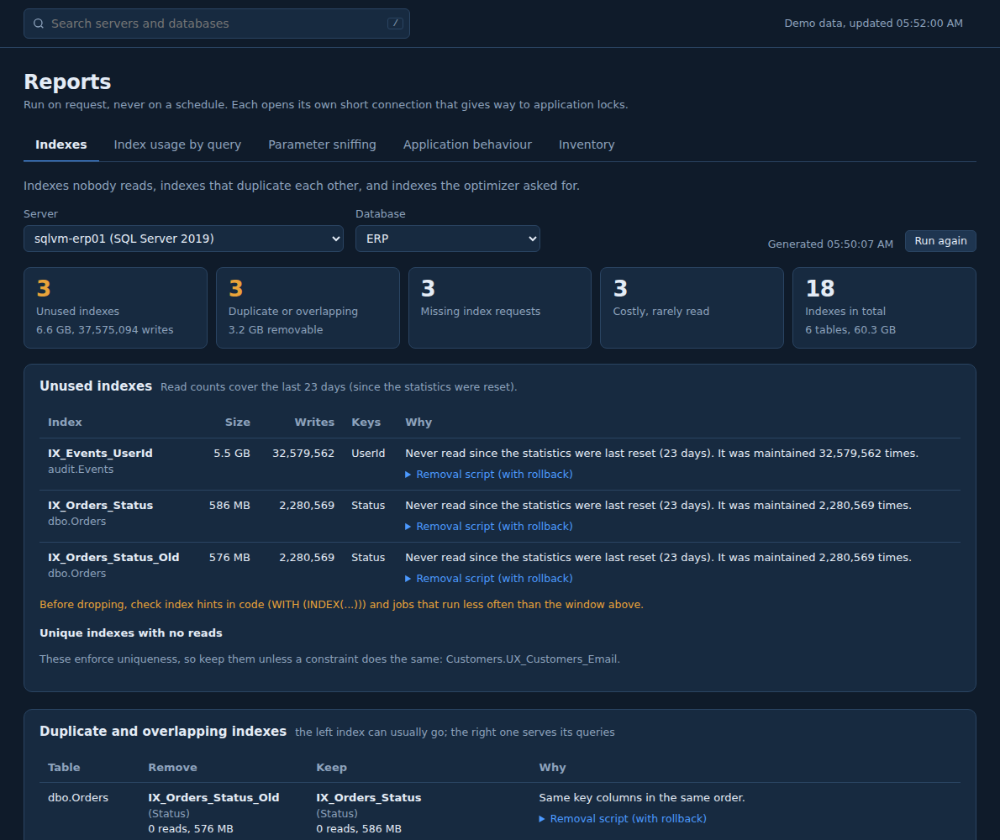
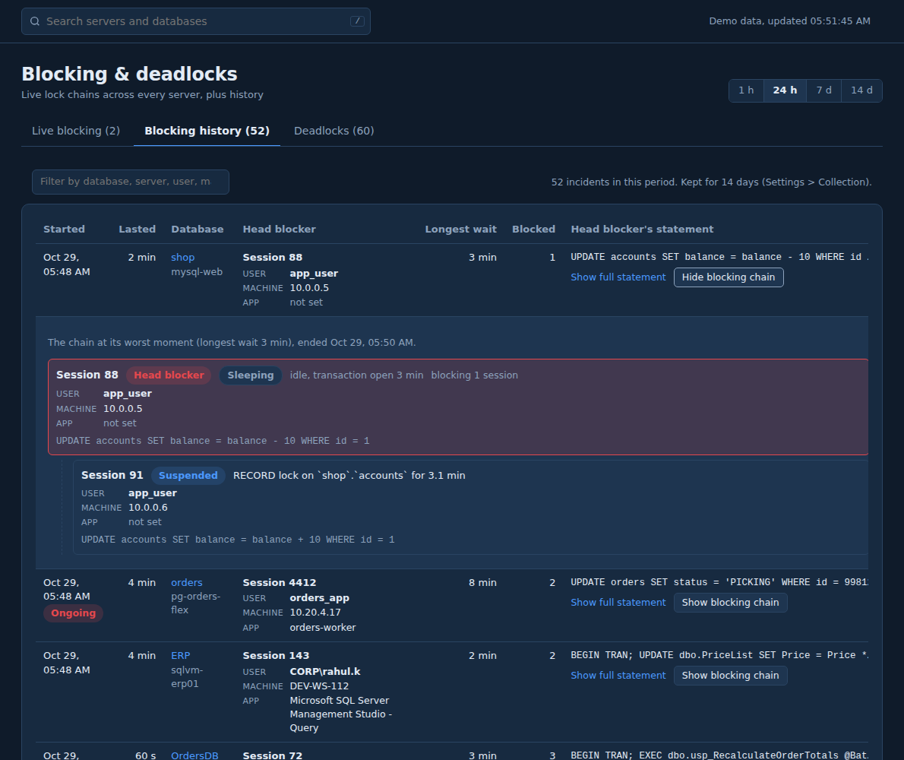

# SQL Monitor (beta)

**Database monitoring that tells you what to fix, for SQL Server, Azure SQL, PostgreSQL and MySQL.**
Free public beta. Your data stays with you.

**[Download the latest beta](../../releases/latest)** &nbsp;|&nbsp; [Website](https://yvinay.github.io/SQLMonitor-Releases/) &nbsp;|&nbsp; [What's new](CHANGELOG.md) &nbsp;|&nbsp; [Send feedback](../../issues/new/choose) &nbsp;|&nbsp; [Discussions](../../discussions)

## New in this beta

- **Seven on-demand reports**: unused, duplicate and missing indexes; index usage by query; parameter sniffing; client timeouts; chatty queries; connection churn; inventory.
- **Complete inventory** of a server, a database or the whole estate, as a graphical HTML report or an Excel workbook, including every database's compatibility level and, for Azure SQL Database, service objective, vCore/DTU, hardware generation and elastic pools.
- **Who ran it, from where**: user, machine, IP address, application and status (Running, Runnable, Suspended, Sleeping) on every page that lists queries.
- **Blocking chains you can trust**: whole chains live and in history, even when the head blocker is connected to another database, with each past incident's chain on one click.
- **A shared console for your DBA team**: sign-in for everyone at https://your-name, roles, idle sign-out and an audit log, with a setup script for Windows Server and IIS.
- **Hardened security** throughout. Full list in the [changelog](CHANGELOG.md).

## What it does

- **Finds the query behind the problem**: CPU, IO, log, blocking, memory, parallelism, plan regressions, missing indexes, with the reason from the execution plan, who runs it, and a copy-ready fix.
- **Response time analysis**: samples active sessions every 2 seconds and shows where database time goes, by query and wait.
- **Time travel**: click any moment to see what was running and who was blocking whom.
- **Running sessions with context**: user, machine, IP, application and status; sleeping sessions that hold open transactions.
- **Blocking and deadlocks**: live chains, incident history with the full chain, deadlock graphs, recurring patterns and how to prevent them.
- **Reports on demand**: indexes, index usage by query, parameter sniffing, client timeouts, chatty queries, connection churn.
- **Inventory**: hardware, versions and compatibility levels, configuration, databases, files, logins, jobs, availability groups; HTML or Excel.
- **Change correlation**: schema, setting, version and plan changes and deployment markers on every chart.
- **Health checks**: backups vs. RPO, Availability Groups, Agent jobs, CHECKDB, capacity forecasts, configuration, security, end of support.
- **Cost right-sizing**: over-provisioned elastic pools, databases, instances and VMs, with monthly savings.
- **Built for large estates and teams**: risk-sorted view of hundreds of databases, search, pause/resume per server, sign-in with roles.

| | |
|---|---|
|  |  |
|  |  |
|  |  |

## Supported platforms

Azure SQL Database (incl. elastic pools), Azure SQL Managed Instance, SQL Server 2016 SP2+ on VMs and on-premises, Amazon RDS for SQL Server, Google Cloud SQL, PostgreSQL 10+ (self-hosted, Azure, AWS, Google Cloud), MySQL 5.7/8.x and MariaDB (self-hosted, Azure, AWS, Google Cloud).

## Install

**On your own PC**
1. Download `SQLMonitorSetup-<version>.exe` from [Releases](../../releases). Windows 10/11 or Server 2016+, 64-bit.
2. Optional: verify it: `Get-FileHash .\SQLMonitorSetup-<version>.exe -Algorithm SHA256` and compare with the `.sha256` file.
3. Run it. The app opens in your browser with **demo data**, so you can explore everything before connecting a server.
4. Create a read-only monitoring login with the setup scripts (Start menu > SQL Monitor > Setup scripts), then add your server under **Servers**.

**On a server, for your whole team**
1. Install for all users on a Windows Server, and install the free IIS modules URL Rewrite and Application Request Routing.
2. Get a DNS name and a certificate for it (for example `sqlmonitor.yourcompany.com`).
3. Run `deploy\windows\Install-SQLMonitorServer.ps1 -HostName sqlmonitor.yourcompany.com -CertificateThumbprint <thumbprint>` as Administrator. It creates the first admin, starts SQL Monitor in the background, and sets up HTTPS in IIS.
4. Your team opens https://sqlmonitor.yourcompany.com and signs in. The guide is in `deploy\DEPLOY_SERVER.md` in the install folder.

SQL Server monitoring needs the Microsoft ODBC Driver 18 (the installer checks and links to it). A Linux / Docker setup for a shared installation is available on request during the beta.

## Safety and privacy

- **Read-only**: it reads monitoring views. It never changes data; fix scripts are shown for you to run yourself. Reports run only on request and give way to application locks.
- **Your data stays with you**: metrics, settings and query text are stored on your PC or your own server. No telemetry. Saved passwords are encrypted.
- **Secure by default**: until sign-in is turned on, it answers only requests from the computer it runs on.
- **Optional network use**: update check (reads this repository's release list) and AI explanations (off by default, your own Anthropic key, literals masked).
- Details: [Privacy](PRIVACY.md) &middot; [Beta terms](BETA-TERMS.md) &middot; [Security](SECURITY.md)

## Feedback shapes the roadmap

Use **Send feedback** in the app (it fills in the version for you), or:
- [Report a problem](../../issues/new?template=bug_report.yml)
- [Suggest an improvement](../../issues/new?template=feature_request.yml)
- [Vote on ideas in Discussions](../../discussions)

The source code is not public during the beta.
